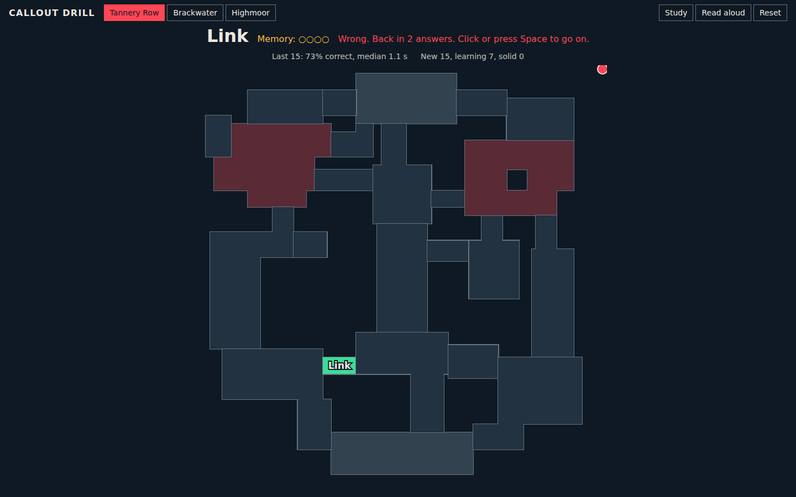

# Callout Drill

A callout appears, you click where it is on the map, and the ones you miss come back sooner.



## Who it is for

New players of tactical shooters. They usually learn callouts from static lists, or from teammates in the middle of a round, when there is no time to ask where something is. This page gives them a place to practise before that.

These are made-up maps. The drill teaches the method and the common vocabulary (Heaven, A Main, Back Site), not real map layouts.

## How to run it

Needs Node 22. There are no runtime dependencies.

```
npm start
```

Then open http://localhost:8000. Use `PORT=9000 npm start` to pick another port.

```
npm test
npm install
npm run smoke
```

`npm test` runs the logic and map checks. `npm run smoke` plays through the page in headless Chromium, so it needs Playwright, which `npm install` adds.

## How it works

Each map is one entry in `data/maps.json`: rooms made of rectangles on a 100 by 100 grid, so a new map gets a drill with no extra code. A shared edge between two rooms means you can walk between them, and `test/maps.test.js` uses that to check that every site can be reached by two separate routes. `src/map.js` draws the rooms as SVG and turns a click into grid units. `src/quiz.js` judges the click, counting anything within 1.5 grid units of the room as correct. The drill never ends. It uses simple spaced repetition: each callout sits in a memory box from 0 to 4, shown as dots beside the prompt. A correct answer moves it up a box, and a miss sends it back to 0. It comes back after 2, 4, 8, 16 or 32 answers depending on its box, and new callouts appear when nothing is due. The score beside the map is your share correct and median time over your last 20 answers. Your progress on each map is kept in your browser's `localStorage`.

## Known limits

- Nobody has played these maps. They were designed on paper around routes, chokes and rotations, and only the checks in `test/maps.test.js` and a look at the drawings back them up.
- The map is flat. Heaven and Hell are drawn beside the site rather than above and below it.
- The 1.5 unit margin means a click just over a shared edge can count for the room next door.
- The gaps, the 20-answer window and the margin are judgment calls, not tested on real learners.
- Gaps count answers, not days, so they suit one sitting. A real memory schedule would also space callouts across days.
- Stats stay in one browser. If storage is blocked the drill still works but forgets them.

Built with Claude Code.
